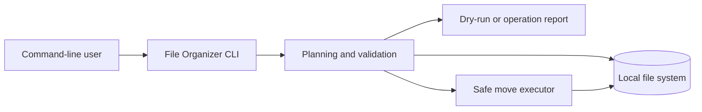

# Automation Toolkit

[](https://github.com/JinyanShao/automation-toolkit/actions/workflows/ci.yml)
[](LICENSE)

Practical Python command-line tools for safe, repeatable file-management and workflow-automation tasks.

## Overview

Automation Toolkit is an automation-tool collection designed to help users perform routine local file operations safely from the command line. The current release contains the File Organizer tool.

The project focuses on:

* Predictable organization of visible top-level files
* Dry-run previews before any filesystem change
* Explicit conflict handling without overwriting data
* Cross-platform tests and quality checks

## Problem

Downloads and working folders quickly become difficult to manage. Manual sorting is repetitive, while a careless automation script can overwrite files, move hidden data, or recursively reorganize content the user did not intend to touch.

Small command-line automations need clear scopes, understandable outcomes, and safeguards that make changes reviewable before execution.

Typical challenges include:

* Repetitive manual file sorting
* Accidental overwrites during filename conflicts
* Hidden files, symlinks, or nested folders being handled unexpectedly
* Different filesystem behavior across operating systems

## Solution

The system addresses these challenges by providing:

* File organization by type, size, or modification year
* A `--dry-run` preview mode before files are moved
* Explicit `skip` and `rename` conflict strategies with no overwrite behavior
* Cross-platform validation on Linux, macOS, and Windows

## Current Status

### Implemented

* File Organizer command-line package for visible, top-level files
* Dry-run reporting, automatic destination directories, and result summaries
* Safe handling of hidden files, symbolic links, subdirectories, and filename conflicts
* pytest, Ruff, coverage threshold, and GitHub Actions checks

### In Progress

* Continued stabilization of File Organizer behavior across supported platforms

### Planned

* A Log Analyzer tool after its workflow is specified
* A CSV Cleaner tool after its interface is specified

Planned capabilities are not included in the current release unless explicitly marked as implemented.

## Architecture



### Main Components

| Component | Responsibility |
| --- | --- |
| Command-line interface | Receives directory, organization mode, and conflict strategy |
| Planner | Inspects eligible files and creates a safe operation plan |
| File-system layer | Creates directories and moves only approved visible top-level files |
| Reporter | Summarizes planned, moved, skipped, and failed operations |
| Test suite | Verifies behavior across supported operating systems |

## Key Engineering Decisions

### Non-recursive, visible-file scope

**Decision:** The File Organizer only processes visible files in the selected directory's top level.

**Reason:** A narrow default avoids surprising changes to nested content, hidden files, and symbolic links.

**Trade-off:** Users who need recursive organization must use a different tool or workflow.

### Dry run and explicit conflict strategies

**Decision:** Operations can be previewed and conflicts require `skip` or `rename` behavior rather than overwriting files.

**Reason:** Filesystem automation should be reviewable and preserve existing content.

**Trade-off:** A real run may require additional user choices when destination names collide.

## Technology Stack

| Area | Technology |
| --- | --- |
| Language | Python 3.10+ |
| Framework | None; argparse command-line interface |
| Database | None |
| Testing | pytest, pytest-cov, Ruff |
| Packaging | Python package |
| CI/CD | GitHub Actions on Ubuntu, macOS, and Windows |

## Repository Structure

```text
.
├── file-organizer/
│   ├── src/file_organizer/  # Python package
│   ├── tests/               # Automated tests
│   ├── README.md            # Tool-specific usage documentation
│   └── pyproject.toml
├── .github/workflows/       # Continuous integration
├── CONTRIBUTING.md
├── CHANGELOG.md
└── README.md
```

## Getting Started

### Prerequisites

* Python 3.10+
* Git

### Installation

```bash
git clone https://github.com/JinyanShao/automation-toolkit.git
cd automation-toolkit/file-organizer
python3 -m pip install -e '.[dev]'
```

### Configuration

No credentials or environment configuration are required.

### Run Locally

Preview a safe organization run before changing files:

```bash
file-organizer ~/Downloads --dry-run
```

## Testing

Run the complete automated test suite:

```bash
cd file-organizer
python3 -m pytest --cov=file_organizer --cov-report=term-missing --cov-fail-under=85
```

Run quality checks:

```bash
python3 -m ruff check src tests
python3 -m ruff format --check src tests
```

## Example Workflow

1. A user selects a directory such as `~/Downloads`.
2. The tool inspects only visible top-level files and creates an operation plan.
3. `--dry-run` reports the intended moves without modifying files.
4. A real run organizes eligible files according to the chosen mode.
5. The tool reports moved, skipped, and failed operations without overwriting existing files.

## Reliability and Safety

The project includes the following reliability measures where applicable:

* Narrow non-recursive scope
* Dry-run previews and explicit conflict strategies
* Hidden-file, symlink, and subdirectory safeguards
* Automated unit tests and cross-platform CI
* Clear operation summaries and no committed credentials

## Limitations

The current version does not yet include:

* Recursive directory organization
* A graphical user interface
* Implemented Log Analyzer or CSV Cleaner tools

These limitations are documented intentionally to distinguish implemented functionality from future work.

## Roadmap

* [ ] Continue stabilizing File Organizer across supported platforms
* [ ] Define and implement a Log Analyzer workflow
* [ ] Define and implement a CSV Cleaner workflow

## Documentation

Additional documentation is available in the repository:

* File Organizer installation and usage guide
* Contribution workflow and quality checks
* Changelog

## Licence

This project is licensed under the MIT License. See `LICENSE` for details.

## Author

Jinyan Shao<br>
Software Engineer — Business Applications, Backend and Automation

* Website: [https://jinyanshao.ch](https://jinyanshao.ch/)
* GitHub: [https://github.com/JinyanShao](https://github.com/JinyanShao)
* LinkedIn: [https://www.linkedin.com/in/jinyanshao/](https://www.linkedin.com/in/jinyanshao/)
